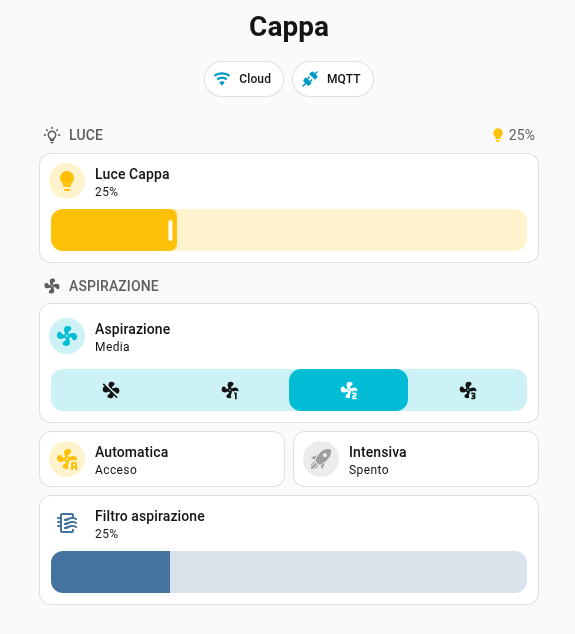
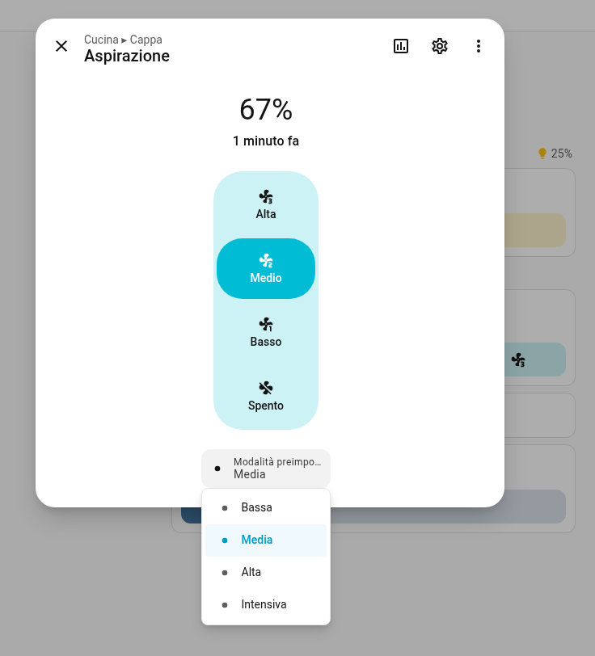
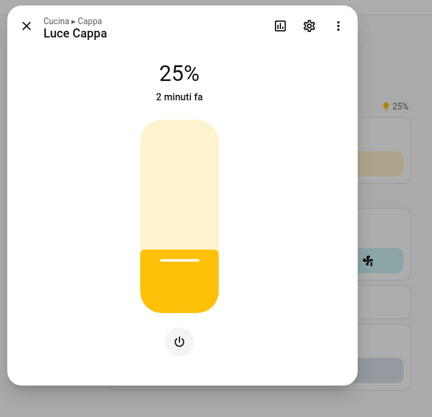
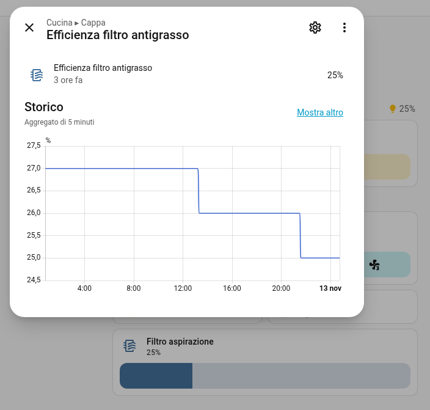
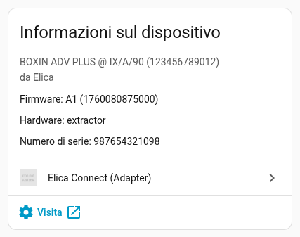
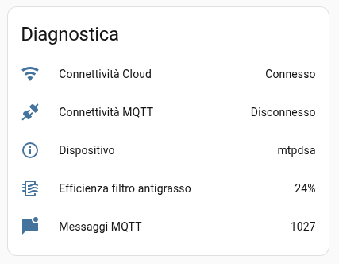
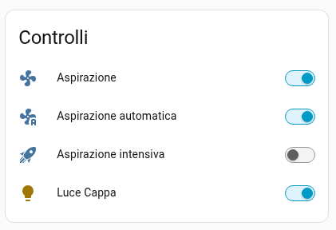
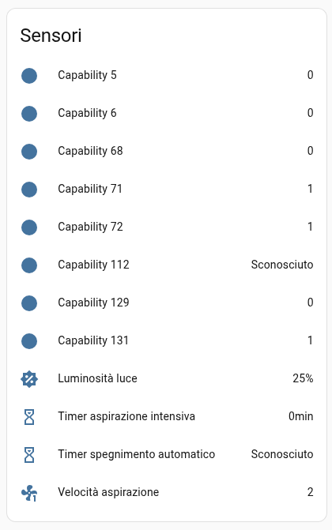
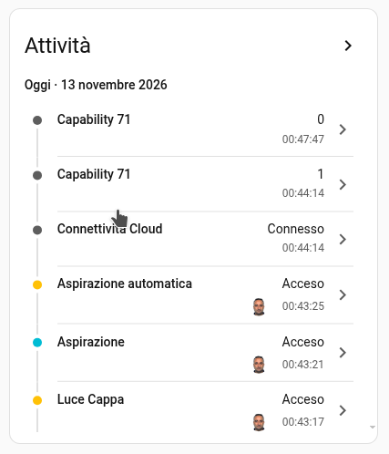

# Elica Connect - Custom Component for Home Assistant

[](https://my.home-assistant.io/redirect/hacs_repository/?owner=ricfio&repository=elica-connect-adapter&category=integration)
[](https://my.home-assistant.io/redirect/config_flow_start?domain=elica_connect_adapter)

Home Assistant custom integration for Elica Connect hoods and compatible
appliances. It connects to the Elica cloud account, discovers the associated
devices, and exposes fan, light, switch, number, and diagnostic sensor entities.

## Installation

### HACS

1. Open HACS in Home Assistant.
2. Open **Integrations** and search for **Elica Connect**.
3. Install the integration and restart Home Assistant.
4. Add **Elica Connect** from **Settings → Devices & services → Add integration**.

If the repository is not yet listed in the HACS default repository, add it as a
custom repository using:

```text
https://github.com/ricfio/elica-connect-adapter
```

Select **Integration** as the repository category.

### Manual

1. Download or clone this repository.
2. Copy `custom_components/elica_connect_adapter` into the `custom_components`
   directory of your Home Assistant configuration.
3. Restart Home Assistant.
4. Add **Elica Connect** from **Settings → Devices & services**.

## Configuration and requirements

Configuration is performed through the Home Assistant UI. Enter the Elica
Connect account username and password used by the official Elica mobile app.

The integration requires:

- Home Assistant `2024.8.0` or newer;
- outbound HTTPS access to the Elica cloud API;
- outbound MQTT access to `cloudprodmqtt.elica.com` on secure port `8883`;
- valid Elica account credentials and at least one compatible connected device.

The application credential used by the official Elica mobile app is bundled in
the integration and is not a personal user credential. User credentials are
stored by Home Assistant in the config entry.

## Troubleshooting

- If setup fails, verify the Elica account credentials and that the account can
  access the device in the official mobile app.
- Ensure the Home Assistant host can reach the Elica API and MQTT endpoint.
- Enable the integration debug option only while troubleshooting; avoid sharing
  logs containing account or device information.

## Supported devices and features

The integration has been verified with the following Elica hood:

| Device | Firmware | Verified features |
| --- | --- | --- |
| BOXIN ADV PLUS IX/A/90 | A1 | Fan control, automatic and intensive modes, light control, fan speed, light brightness, timers, grease filter efficiency, Cloud connectivity, MQTT connectivity, and MQTT message diagnostics |

Support for other Elica Connect devices may vary according to the capabilities
reported by the Elica cloud service. If your device is not listed, open an issue
with the model name and anonymized diagnostic information. Do not include serial
numbers, account identifiers, access tokens, passwords, or complete MQTT payloads.

### Entities provided

- **Fan:** power, percentage, speed presets, intensive mode, and automatic mode.
- **Light:** on/off and brightness where supported by the device.
- **Sensors:** fan speed, light brightness, intensive timer, auto-off timer,
  grease filter efficiency, Cloud connectivity, MQTT connectivity, and MQTT
  message statistics.
- **Switches:** intensive and automatic operation modes.

## Screenshots

The following screenshots show the integration running in Home Assistant with a
verified Elica hood, including the dashboard, controls, entities, diagnostics,
and device history.

<table>
  <tr>
    <td></td>
    <td></td>
  </tr>
  <tr>
    <td></td>
    <td></td>
  </tr>
  <tr>
    <td></td>
    <td></td>
  </tr>
  <tr>
    <td></td>
    <td></td>
  </tr>
  <tr>
    <td></td>
  </tr>
</table>

## Sensors Documentation

This integration provides a comprehensive set of entities and sensors for Elica connected devices (hoods and appliances), divided into connectivity, capability telemetry, and MQTT diagnostics.

### 1. Connectivity Sensor
- **Entity Name:** Connectivity (`connectivity`)
- **Category:** Diagnostic (`SensorDeviceClass.ENUM`)
- **States:** `connected`, `disconnected`
- **Description:** Monitors whether the device is currently connected to the Elica cloud / network service based on the device's connection status.

### 2. Capability Sensors
Elica devices communicate via numerical capability codes reported in the device's data model. The integration maps these capabilities to dedicated sensors and climate/fan/light entities:

| Code | Description | Type | Unit | HA Mapping |
| ---: | :--- | :---: | :---: | :--- |
| **64** | Fan Mode (bitmask) | int | - | Fan Entity & Sensor |
| **69** | Fan Boost Timer (remaining) | int | min | Sensor (`Duration`) |
| **96** | Light Brightness | int | % | Light Entity & Sensor |
| **110** | Fan Speed | int | - | Fan Entity & Sensor |
| **128** | Grease Filter Saturation / Efficiency | int | % | Diagnostic Sensor (`PERCENTAGE`) |

#### Detailed Capability Breakdown:
- **Fan Mode (`64`):** Bitmask representing operational flags (`0` = Off, `1` = Fan active, `4` = Intensive mode active, `32` = Airmatic mode active).
- **Boost Timer (`69`):** Remaining countdown time in minutes for intensive boost mode.
- **Light Brightness (`96`):** Current brightness percentage of the hood lights (`0–100%`).
- **Fan Speed (`110`):** Current fan speed level (`0–3`).
- **Grease Filter Efficiency (`128`):** Reports filter wear level and efficiency (`100 - saturation`). Includes extra state attributes detailing filter ID, type, status, saturation alert, installation date, and last reset.

### 3. MQTT Diagnostic Sensors
- **MQTT State (`mqtt_state`):**
  - **Class:** Diagnostic (`SensorDeviceClass.ENUM`)
  - **States:** `connected`, `disconnected`
  - **Attributes:** Broker URL, client ID (`eiot-app`), last connection timestamp, last disconnection timestamp.
- **MQTT Messages (`mqtt_messages`):**
  - **Class:** Diagnostic (`SensorStateClass.TOTAL_INCREASING`)
  - **Description:** Total number of received MQTT telemetry messages.
  - **Attributes:** Last message timestamp, last message payload.

---

## Appendix

### Device Capabilities Reference Table

|    Code | Description                 | Type  | Unit | Constraints | Observed Values | HA Mapping          |
| ------: | :-------------------------- | :---: | :--: | :---------: | :-------------: | :------------------ |
|   **5** |                             |       |      |             | 0               |                     |
|   **6** |                             |       |      |             | 0               |                     |
|  **64** | Fan Mode (bitmask)          | int   |      |             | 0, 1, 5, 32     | Fan Entity          |
|  **68** |                             |       |      |             | 0               |                     |
|  **69** | Fan Boost Timer (remaining) | int   | min  | 5-0         | 5..0 (minutes)  | Sensor (Duration)   |
|  **71** |                             |       |      |             | 0               |                     |
|  **72** |                             |       |      |             | 1               |                     |
|  **96** | Light Brightness            | int   | %    | 0-100       | 0..100          | Light Entity        |
| **110** | Fan Speed                   | int   |      | 0-3         | 0               | Fan Entity          |
| **112** |                             |       |      |             | -               | None                |
| **128** | Grease Filter Saturation    | int   | %    | 0-100       | 0..100 (%)      | Sensor (Diagnostic) |
| **129** |                             |       |      |             | 0               |                     |
| **131** |                             |       |      |             | 1               |                     |

*Note:*  
*Capability rows without description and mapping are reserved / unmapped slots observed in device telemetry.*
